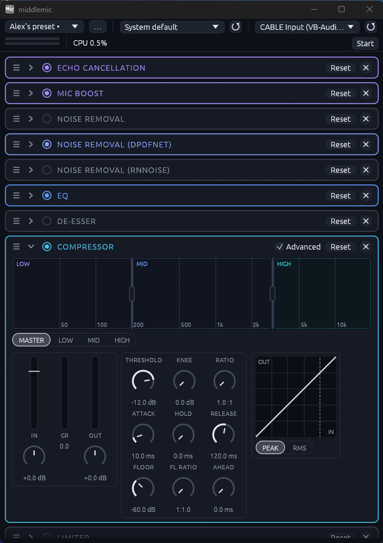

# middlemic

Lightweight mic processing for Windows. Takes your headset mic, runs it through a rack of
effects, and plays the result into a virtual audio cable so Discord, OBS and games can use
it as a normal microphone.

```
Headset mic ──► middlemic (rack of stages) ──► CABLE Input ══► "CABLE Output" microphone
```

No DAW, no routing maze, no plugin host. One small executable.



## First run

The first time you open middlemic, a short setup walks you through three steps. You can run it
again any time from **Settings → Run setup again**.

1. **Cable.** Discord and games can only listen to a microphone, so middlemic plays into a
   virtual cable, [VB-CABLE](https://vb-audio.com/Cable/), and they listen to its other end.
   **Install** downloads it from vb-audio.com, checks the installer's digital signature and
   runs it with the usual Windows admin and driver-trust prompts. **Skip** if you already
   have it, or use another cable. This step is skipped on its own when the cable is installed.
2. **Microphone.** Every recording device is listed with a live level bar, so you can say
   something and see which one hears you. "Windows default" is offered too. The Windows
   default recording device is pre-selected, never `CABLE Output`.
3. **Output.** `CABLE Input` is pre-selected. In Discord, OBS or a game, pick **`CABLE Output`**
   as your microphone; middlemic plays into `CABLE Input`. Choose another output only if you
   know what you are doing.

Nothing from VB-Audio is stored in this repository. VB-CABLE is donationware by VB-Audio
([www.vb-cable.com](https://vb-cable.com)); all participations are welcome.

## The rack

The window is a rack of stages, in running order. Each row has a fold arrow, a power switch
(a bypassed stage passes sound through untouched and adds no delay), a reset, and a live
gain-reduction readout where it makes sense. Drag a row's grip to reorder the chain while it
runs. Hover any control for a plain-language tip.

| Stage | What it does |
| --- | --- |
| **Feedback suppressor** | Spots speaker-to-mic howls by FFT and cuts each with a narrow notch that fades once the howl is gone. A strip shows each notch's pitch and depth. |
| **Echo cancellation** | WebRTC AEC3, pure Rust. Removes what your speakers play from your mic. It listens to the default playback device through WASAPI loopback, so set Windows playback to your speakers or headphones, not the cable. If the cable is the default, the stage idles rather than erase your own voice. Off by default. |
| **DPDFNet** | The default noise removal: removes fans, hum, keyboard and room noise and keeps speech clear. Needs a one-time model download (see below). Adds about 50 ms and uses roughly 40% of a core. |
| **DeepFilterNet** | The previous noise removal, kept to compare. Cheaper than DPDFNet, adds 30 ms, and removes more speech at the same cap. Off by default. |
| **RNNoise** | A very cheap noise remover (about 1% of a core, 10 ms). Off by default. |
| **Mic boost** | Plain gain. |
| **EQ** | A plugin-style EQ: response curve over a live spectrum, draggable band dots, a row of knobs per band, and a scrolling spectrogram with the de-esser's frequency marked. |
| **De-esser** | Tames harsh "s" sounds, with a gain-reduction meter. |
| **Compressor** | A Maximus-style multiband compressor. Simple mode is one Amount slider plus Gentle, Voice and Strong; Advanced mode shows every dial. |
| **Limiter** | A last stage that stops peaks clipping. |

The three noise removers have a **Max reduction** knob: the most noise each may remove, in dB.
At 18 dB speech stays natural; raise it for a noisier room.

**DPDFNet model.** The row shows a **Download model** button until the file is installed. It
fetches `dpdfnet2_48khz_hr.onnx` (Ceva, Apache-2.0, from huggingface.co/Ceva-IP/DPDFNet) at a
pinned revision, checks its SHA-256 and saves it to `%APPDATA%\middlemic\models`. The stage
starts working as soon as the file lands. A copy in a `models` folder next to the exe works too.

### Add, remove and multiple instances

The dashed **+** row under the stages opens a menu of every kind and adds one to the bottom of
the rack; drag it where you want it. You can have more than one of the same kind, each with its
own settings: two EQs, say, or a compressor before and after the EQ. Remove a stage with the ✕
on its row; an undo stays on screen briefly.

## Presets

The preset picker at the top loads a whole rack in one click, and you can keep switching while
it runs. The **…** menu saves, saves as, renames and deletes your own presets, which live in
`%APPDATA%\middlemic\presets`. A dot after the name means you have changed the rack since
loading. Device choices are not part of a preset.

Built in:

- **Default**: one of each stage, DPDFNet on.
- **Alex's preset**: echo cancellation, mic boost, DPDFNet, EQ and the compressor on; DeepFilterNet, RNNoise, the de-esser and the limiter off.

## Settings

The gear in the top bar opens the settings page, which replaces the rack until you press **Back**.

- **Devices**: the microphone and output pickers and a refresh button. Locked while running.
- **Launch when Windows starts**: adds a value under `HKCU\Software\Microsoft\Windows\CurrentVersion\Run`, so it needs no administrator permission, and starts middlemic minimised. It shows up in Task Manager's Startup apps.
- **Storage**: lists what is in `%APPDATA%\middlemic` (models, presets, settings.ini) with sizes. Each has its own **Delete**. **Reset everything** deletes all of it, puts every setting back and runs the setup again, after you confirm on the page.
- **VB-CABLE**: **Install / reinstall**, and **Run setup again**.
- **Updates**: **Check for updates**, then **Download** and **Install and restart** as separate steps, so a download can wait for a good moment. A checkbox turns off the check at start. Settings, presets and models are kept.
- **Meters**: how slowly the Input and Output level bars fall.

## Releases and updates

`make release` runs the tests, tags the next version from the commit emoji since the last tag (💥 major, ✨ minor, anything else patch; `V=v1.2.3` overrides) and pushes it. The `release` workflow then builds `middlemic.exe` on GitHub, with its `SHA256SUMS`, and publishes a release. Download `middlemic.exe` from the latest release and put it anywhere you can write to; there is no installer.

A release build checks the latest release when it starts (one request to `api.github.com`, nothing else). A download is saved under `%APPDATA%\middlemic\updates` and only moved into place if its SHA-256 matches `SHA256SUMS`. Installing renames the running exe to `middlemic.exe.old`, copies the new one in, and starts it; the old file is deleted on the next launch. The checksum guards against a damaged download, not a compromised GitHub account. Local builds report as `dev` and never update. An exe in a folder you cannot write to (such as Program Files) cannot update itself.

## Build

Cross-compiles from Linux or WSL:

```sh
rustup target add x86_64-pc-windows-gnu
sudo apt install mingw-w64
cargo build --release --target x86_64-pc-windows-gnu
```

Or with make: `make build`, `make test`, and `make open`, which builds if anything changed and
then starts the window on Windows (WSL only). Each `make open` starts another copy, so close the
old window first.

Two dependencies are pinned on purpose. `tract-*` is `=0.21.4` because 0.21.19 breaks
`deep_filter`, and `deep_filter` is a git dependency at a fixed revision of
[Rikorose/DeepFilterNet](https://github.com/Rikorose/DeepFilterNet) (MIT OR Apache-2.0),
because the crates.io release has no inference code.

## Test

```sh
cargo test --release
```

This runs on Linux. It covers the DSP and also draws the UI headless, including the wizard and
the settings page at 420 and 800 points wide. A few tests are `#[ignore]`d because they need a
recording; see below.

## Command line

```sh
middlemic.exe                  # opens the window
middlemic.exe --minimized      # opens it minimised (what "Launch when Windows starts" uses)
middlemic.exe devices          # list device names
middlemic.exe run --input "Headset Microphone" --output "CABLE Input"   # no window, saved settings
```

## Testing with a recording

The ignored tests run a real recording (anything `symphonia` can decode, such as `.m4a`)
through the rack in 10 ms frames, as the live engine does. Run them by name:

```sh
export MIDDLEMIC_TEST_AUDIO=/path/to/recording.m4a MIDDLEMIC_TEST_OUT=/path/to/output-dir
export MIDDLEMIC_MODELS=/path/to/dir-with-the-onnx-model     # for DPDFNet
cargo test --release compare_denoisers  -- --ignored --nocapture   # the three denoisers side by side
cargo test --release feedback_on_recording -- --ignored --nocapture   # does the feedback suppressor misfire?
cargo test --release analyse_chain -- --ignored --nocapture   # per-frame timing, gating
cargo test --release analyse_cap   -- --ignored --nocapture   # noise removal strength sweep
cargo test --release measure_delay -- --ignored --nocapture   # real delay of each stage
```

Processed `.wav` files are written to `MIDDLEMIC_TEST_OUT` so you can listen to the result.
When the output is lined up against the input, allow for the noise removal's delay, or every
word edge looks cut.

`compare_denoisers` prints, per remover and cap, the delay, how much quieter the pauses get
(more is better), how much quieter speech gets (less is better) and how many words dip by over
6 dB. On two test recordings at an 18 dB cap, speech loss in dB was:

| Recording | DeepFilterNet | DPDFNet | RNNoise |
| --- | --- | --- | --- |
| Quiet room | 2.1 | 0.5 | 0.45 |
| Background noise | 4.56 | 3.36 | 2.99 |

On the noisy one the pauses get quieter by 14.5, 15.1 and 13.6 dB. DPDFNet cleans pauses most
and loses less speech than DeepFilterNet in both; RNNoise loses the least speech but is cheapest
and cleans pauses a little less.

## Licence

MIT OR Apache-2.0, at your option.
